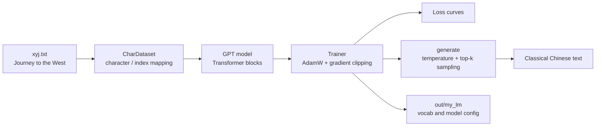

# miniGPT: A Character-Level Chinese Language Model

[English](README.md) | [简体中文](README_CN.md)

[](https://www.python.org/)
[](https://pytorch.org/)
[](https://numpy.org/)
[](https://jupyter.org/)
[](https://opensource.org/licenses/MIT)

## Introduction

This project is built on [minGPT](https://github.com/karpathy/minGPT) by Andrej Karpathy. Its goal is to train a character-level language model from scratch and to make the whole pipeline — data preparation, model definition, training, and inference — easy to follow in a single notebook.

The training corpus is *Journey to the West* (`xyj.txt`), roughly 740,000 Chinese characters. The trained model generates text in the style of classical Chinese literature.

What the notebook implements:

- Character-level tokenization with a bidirectional character/index mapping
- A GPT model: token and position embeddings, multi-head causal self-attention, pre-LN Transformer blocks, GELU feed-forward network
- A training loop with AdamW, weight-decay grouping, and gradient clipping
- Loss visualization and text generation with temperature and top-k sampling



## Requirements

- [](https://www.python.org/) Python 3.11 or newer
- [](https://pytorch.org/) PyTorch 2.0 or newer
- [](https://numpy.org/) NumPy 1.24 or newer
- [](https://matplotlib.org/) Matplotlib for loss curves and character frequency plots
- [](https://jupyter.org/) Jupyter Notebook to run the cells

A CUDA-capable GPU is recommended but not required; the notebook falls back to CPU automatically.

## Project Structure

```
.
├── minGPT.ipynb    # main notebook: data prep, model definition, training, inference
├── xyj.txt         # training corpus: full text of Journey to the West
├── LICENSE         # MIT license
├── README.md       # English documentation (this file)
└── README_CN.md    # 中文文档
```

Running the notebook also creates `./out/my_lm/`, which holds the saved vocabulary mappings and model configuration.

## Usage

Install the dependencies:

```bash
pip install torch numpy matplotlib jupyter
```

Open the notebook and run the cells in order:

```bash
jupyter notebook minGPT.ipynb
```

The notebook is organized into six parts:

1. **Imports** — standard library, PyTorch, and matplotlib setup.
2. **Constants** — random seed, hyperparameters, data path, and device selection.
3. **Data processing** — `CharDataset` builds the vocabulary and yields `(x, y)` sequence pairs.
4. **Model** — `NewGELU`, `CausalSelfAttention`, `Block`, and the full `GPT` model.
5. **Training** — the `Trainer` loop prints the loss periodically and plots raw and smoothed loss curves.
6. **Inference** — generate text from a prompt and save the vocabulary/configuration to `./out/my_lm/`.

Default hyperparameters:

```python
@dataclass # default model config
class Config:
    batch_size: int = 64;
    block_size: int = 128;
    n_embd: int = 512;
    vocab_size: int = None;
    n_layer: int = 2;
    n_head: int = 2;
    dropout: float = 0.1;
    bias: bool = True;
    grad_norm_clip: float = 1.0; # gradient clipping threshold
config = Config();
```

To generate text after training, use the helper defined in the inference cell:

```python
prompt = "孙";
generated = generate_text(prompt, max_tokens=100, temperature=0.8);
print(f"生成结果: {generated}");
```

If you trained on Kaggle, point `train_data` at the mounted dataset path, for example `/kaggle/input/datasets/ailananjuxi/xiyouji/xyj.txt`; locally, change it to the path of your own `xyj.txt`.

## Contributing

Issues and pull requests are welcome.

1. Fork the repository and create a feature branch.
2. Keep the notebook structure intact and follow the existing code style.
3. Run the whole notebook top to bottom before submitting, and clear large cell outputs if they are not needed.
4. Describe what you changed and why in the pull request.

For bugs or feature ideas, open an issue with the notebook cell, the error message, and your environment (Python/PyTorch version, CPU or GPU).

## Contact

**谙弆悕博士（Ailan Anjuxi）**

- 📫 Email: [anjuxi.ME@outlook.com](mailto:anjuxi.ME@outlook.com)
- 📞 SIP: [sip:anjuxi@sip.linphone.org](sip:anjuxi@sip.linphone.org)

## License

This project is based on [minGPT](https://github.com/karpathy/minGPT) and is released under the MIT License. See [LICENSE](LICENSE) for the full text.

## References

- [minGPT — Andrej Karpathy](https://github.com/karpathy/minGPT)
