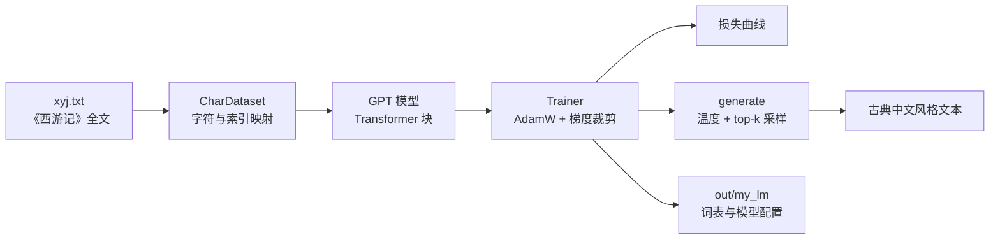

# miniGPT：字符级中文语言模型

[English](README.md) | [简体中文](README_CN.md)

[](https://www.python.org/)
[](https://pytorch.org/)
[](https://numpy.org/)
[](https://jupyter.org/)
[](https://opensource.org/licenses/MIT)

## 项目介绍

本项目基于 Andrej Karpathy 的 [minGPT](https://github.com/karpathy/minGPT)，目标是从零开始训练一个字符级语言模型，并在一个 Notebook 里完整走通数据处理、模型搭建、训练和推理的整个流程。

训练语料是《西游记》全文（`xyj.txt`），约 74 万个汉字。训练完成后，模型可以按照提示生成带有古典白话小说风格的文本。

Notebook 实现的内容：

- 字符级分词，建立字符与索引的双向映射。
- GPT 模型：词嵌入与位置嵌入、多头因果自注意力、Pre-LN 结构的 Transformer 块、GELU 前馈网络。
- 训练循环：AdamW 优化器、权重衰减分组、梯度裁剪。
- 损失曲线可视化和文本生成，支持温度采样和 top-k 采样。



## 依赖说明

- [](https://www.python.org/) Python 3.11 及以上。
- [](https://pytorch.org/) PyTorch 2.0 及以上。
- [](https://numpy.org/) NumPy 1.24 及以上。
- [](https://matplotlib.org/) Matplotlib，用于绘制损失曲线和字符频率图。
- [](https://jupyter.org/) Jupyter Notebook，用于按单元格运行代码。

有 CUDA 显卡更好，没有也可以，Notebook 会自动退回 CPU 运行。

## 项目结构

```
.
├── minGPT.ipynb    # 主 Notebook：数据处理、模型搭建、训练、推理
├── xyj.txt         # 训练语料：《西游记》全文
├── LICENSE         # MIT 许可证
├── README.md       # 英文文档（主文档）
└── README_CN.md    # 中文文档（本文件）
```

Notebook 运行后还会生成 `./out/my_lm/` 目录，保存词表映射和模型配置。

## 使用说明

安装依赖：

```bash
pip install torch numpy matplotlib jupyter
```

打开 Notebook，按顺序运行单元格：

```bash
jupyter notebook minGPT.ipynb
```

Notebook 分为六个部分：

1. **依赖导入**：标准库、PyTorch 和 matplotlib 环境设置。
2. **常量定义**：随机种子、超参数、数据路径和设备选择。
3. **数据处理**：`CharDataset` 建立词表，输出 `(x, y)` 序列对。
4. **模型搭建**：`NewGELU`、`CausalSelfAttention`、`Block` 和完整的 `GPT` 模型。
5. **模型训练**：`Trainer` 训练循环定期打印损失，并绘制原始和平滑后的损失曲线。
6. **效果测试**：按提示生成文本，并把词表和配置保存到 `./out/my_lm/`。

默认超参数：

```python
@dataclass # 默认模型配置。
class Config:
    batch_size: int = 64;
    block_size: int = 128;
    n_embd: int = 512;
    vocab_size: int = None;
    n_layer: int = 2;
    n_head: int = 2;
    dropout: float = 0.1;
    bias: bool = True;
    grad_norm_clip: float = 1.0; # 梯度裁剪阈值。
config = Config();
```

训练完成后，使用推理单元格里定义的辅助函数生成文本：

```python
prompt = "孙";
generated = generate_text(prompt, max_tokens=100, temperature=0.8);
print(f"生成结果: {generated}");
```

如果在 Kaggle 上训练，把 `train_data` 改成挂载的数据集路径，例如 `/kaggle/input/datasets/ailananjuxi/xiyouji/xyj.txt`；在本地运行时，改成你自己 `xyj.txt` 所在的路径。

## 贡献指南

欢迎提交 Issue 和 Pull Request。

1. Fork 本仓库，并新建一个特性分支。
2. 保持 Notebook 的章节结构，遵循现有代码风格。
3. 提交前从头到尾完整运行一遍 Notebook，不需要的大体积输出请清空。
4. 在 Pull Request 里说明改了什么、为什么改。

报告 bug 或提出新想法时，请在 Issue 中附上出错的单元格、报错信息和运行环境（Python/PyTorch 版本、CPU 或 GPU）。

## 联系作者

**谙弆悕博士（Ailan Anjuxi）**

- 📫 邮箱：[anjuxi.ME@outlook.com](mailto:anjuxi.ME@outlook.com)
- 📞 SIP 电话：[sip:anjuxi@sip.linphone.org](sip:anjuxi@sip.linphone.org)

## 许可证

本项目基于 [minGPT](https://github.com/karpathy/minGPT)，采用 MIT 许可证，完整条款见 [LICENSE](LICENSE)。

## 参考

- [minGPT — Andrej Karpathy](https://github.com/karpathy/minGPT)
